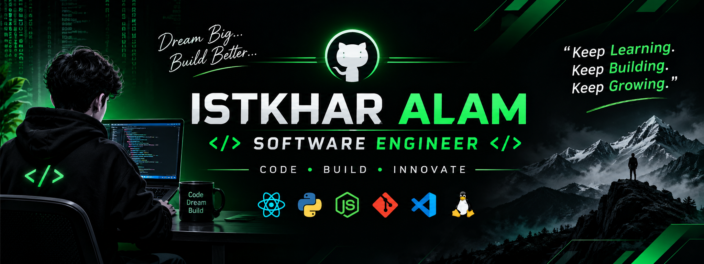

  

<h1 align="center">Hi 👋, I'm Istkhar Alam</h1>
<h3 align="center">Aspiring Software Engineer | B.Tech CSE Student</h3>

  Passionate about building practical software solutions and learning new technologies.

---

## 👨‍💻 About Me

- 🎓 B.Tech Computer Science Engineering Student
- 💻 Aspiring Software Engineer
- 🌱 Currently learning Python, DSA and Backend Development
- 🚀 Interested in building real-world projects
- 🎯 Goal: Become a skilled Software Engineer

## 🛠️ Tech Stack

  

## 📚 Currently Learning

- Python Programming
- Data Structures & Algorithms
- Backend Development
- Problem Solving

## 📊 GitHub Statistics

  

  

---

<h3 align="center">Keep Learning | Keep Building | Keep Growing 🚀</h3>
